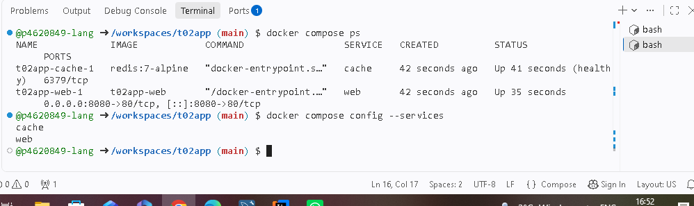

# t02app# Project 2 ## Build Image docker build -t demo:multi . ## Start Services docker compose up -d ## Check Services docker compose ps docker compose config --services ## Stop Services docker compose down ## Run Function cd local-fn sam local invoke HelloWorldFunction